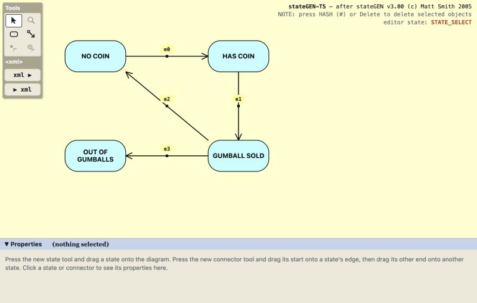
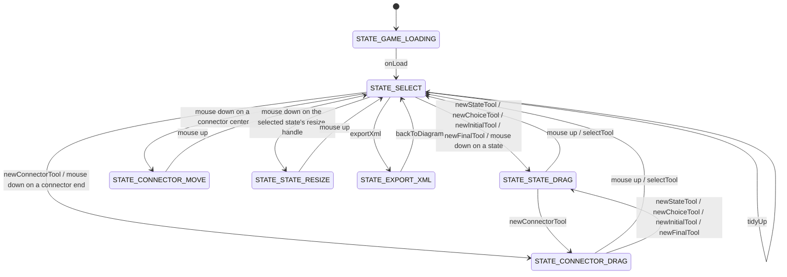

# stateGEN-TS

A TypeScript port of **stateGEN** (Matt Smith, 2005), a Flash tool for drawing state charts and
generating game code from them. The Flash original is in `../stateGEN_flash`.



## What stateGEN does

1. You **draw a state diagram**: state boxes, plus connectors (transitions) between them. Each connector
   has the event that fires it (a frame event, a button press, a key, or a user-defined event) and an
   optional list of actions (functions to call). Each state can have a Flash frame name and
   ENTRY, DO and EXIT behaviours (functions to call).
2. **Export XML** writes the diagram as a `game.xml` file.
3. In 2005, `A_GEN_STATE_CODE.bat` then ran `xsl/gameCode.xsl` over `game.xml` to generate
   `gameStateCode.as`: ActionScript with a `switch` on the current state and a `switch` on the event.

The interesting part for this week: **stateGEN is a state machine itself**. Its own behaviour was written
as a `game.xml` (in `examples/stateGEN-itself.xml`) and then generated by stateGEN. This port turns
that state machine into the **State pattern**.

## The State pattern in this project

| Pattern role | Class | File |
|---|---|---|
| Context | `StateGenEditor` | `src/editor/StateGenEditor.ts` |
| State (abstract) | `EditorState` | `src/editor/EditorState.ts` |
| Concrete states | `LoadingState`, `SelectState`, `StateDragState`, `StateResizeState` (new), `ConnectorDragState`, `ConnectorMoveState`, `ExportXmlState` | `src/editor/states/` |

`EditorState` has one method per event in the original `game.xml`: `onLoad`, `onEnterFrame`,
`onMouseDown/Move/Up`, `onNewStateTool`, `onDeleteKey` and so on. By default each method does nothing.
Each concrete state overrides only the events that its `<state>` element handled in `game.xml`. The
editor never asks "which state am I in?". It just calls `this.state.onMouseDown(p)`.



How things are drawn also depends on the state. The Flash `drawStateObjects()` asked
`if( applicationBUILT_IN.state == STATE_SELECT )`. Here each state answers `stateLook()` and
`connectorLook()` itself. For example, only `SelectState` highlights what is under the mouse, and only
`ConnectorDragState` shows the red snap handles.

The current editor state is shown by which tool in the Tools palette (top right) is pressed down.

### Two related ideas, for comparison

- **Event groups** (`src/model/TransitionEvents.ts`): the Flash version kept an `eventGroup` number on
  each connector and repeated the same 4-way `switch` in three functions. Here there is one class per
  kind of event (`CompletionEvent`, `TimeEvent`, `FrameEvent`, `WebEvent`, `CustomNamedEvent`), so each
  `switch` became a method ("Replace Type Code with Subclasses"): its label, its XML attributes and its
  version 1/2 id. (Version 3 replaced the Flash button, key, mouse and user
  defined classes with `WebEvent` and `CustomNamedEvent`: each a class, so nothing else had to change.)
- **XML version 2** (`<game version='2'>`, designed in `TDDs/version02.md`): actions are lists of
  `<action call='name'/>` instead of code, and in the editor a comma-separated list. An action or guard
  written `name(p)` on a mouse or button event is meant to be passed the mouse position, `p: Point`. A
  state can have `screen='...'` (the HTML element to show when the state is entered) and typed
  `<property name type value/>`s. `<mouseArea id='diagram'/>` makes mouse down count only on that
  element. A state's DO behaviours are saved as `<doStateActions>`. A diagram that uses none of this is
  still written as version 1. In the Properties panel, a state has fields for its screen and its
  properties (`highlightHover = true, zoom = 1.5, label = "hi"`: the type comes from the value).
- **XML version 3** (`<game version='3'>`, designed in `TDDs/version03.md`): web page events. The Flash
  button, mouse, key and user-defined groups are replaced by one **web event**, "this DOM event, on this
  target", chosen from a palette of 29 events (`src/model/WebEvents.ts`: pointer, keyboard, form, media,
  CSS, page, drag and drop), e.g. `<event on='click' target='playButton'>`, `<event on='ended'
  target='film'>`, `<event on='keydown' key='d' mod='mod'>` (Ctrl-D, or Cmd-D on a Mac). Arrows are
  labelled `playButton.click`, `film.ended`, `keydown(mod+d)`. A **custom event** (`<event
  custom='GAME_OVER'>`) is fired by the page's code, e.g. with
  `document.dispatchEvent(new CustomEvent("GAME_OVER"))`. An action or guard written `name(e)` is meant to
  be passed the browser's event (`MouseEvent`, `KeyboardEvent` ...). Old files are converted as they are read, and a diagram whose events all have a version
  1/2 id is still **saved in its old version**, byte for byte; version 3 is only written when an event
  needs it.
- **stateGEN's own state machine**: `examples/stateGEN-itself-v3.xml` is the editor's own state machine
  in version 3 (it is in the Import dialog's examples). Compare the diagram with the hand-written states in
  `src/editor/states/`.
- **Choice diamonds** (`src/model/ChoicePoint.ts`) are a subclass of `DiagramState` that only changes the
  shape (`contains()`, `compassPoint()`, `outlinePointToward()`), so dragging, snapping and deleting work
  on them unchanged. `src/model/Transitions.ts` follows each arrow through any diamonds, so the exporter
  only ever sees guarded transitions between real states.

## Project structure

```
src/
  main.ts                 wires the page up to the editor (every DOM event goes straight to the editor)
  examples.ts             GENERATED by build.ts from examples/*.xml, built in for the Import dialog - don't edit
  model/                  plain data, no State pattern
    geometry.ts             Point, distance, Compass (the 8 snap points), upperCaseUnderScored()
    DiagramState.ts         a state box on the diagram (the Flash "StateMC" movie clip)
    ChoicePoint.ts          a choice (decision) diamond: a DiagramState with a different shape
    Pseudostates.ts         the initial dot and final bullseye: DiagramStates that are circles
    ConnectorEnd.ts         one end of a connector: floating, or snapped to a state's compass point
    Connector.ts            a transition arrow, with its event and actions
    Actions.ts              action lists ("name(p)" gets the mouse position), state properties (version 2)
    TransitionEvents.ts     CompletionEvent / TimeEvent / FrameEvent / WebEvent / CustomNamedEvent
    WebEvents.ts            the palette of web page events (version 3), key names and old key codes
    Diagram.ts              all states + connectors; "what is near the mouse?", snapping
    Transitions.ts          the transitions between real states, following arrows through choices
    Layout.ts               "tidy up": a grid layout with as few crossing arrows as possible
  editor/                 THE STATE PATTERN
    Editor.ts               what the page needs from an editor, and EditorView (what an editor needs from the page)
    StateGenEditor.ts       the Context
    EditorState.ts          the abstract State
    states/*.ts             one class per state from stateGEN's own game.xml
    importReport.ts         import XML and say what happened
  io/
    XmlExporter.ts          diagram -> game.xml (same format as the Flash version)
    XmlImporter.ts          game.xml -> diagram (new: on the Flash version's TODO list)
  view/
    DiagramView.ts          draws the diagram as SVG
    PropertiesPanel.ts      the Properties panel at the bottom
    labels.ts               where to put the arrows' labels so they don't overlap
    Minimap.ts              the small picture of the whole diagram, bottom right
    Viewport.ts             panning and zooming: diagram <-> screen coordinates, and "fit"
public/                   index.html and css/styles.css, copied into dist/ as they are
tests/                    Deno tests: editor states, XML export/import
  fixtures/               old examples the tests still use (the Flash version's games, stateGEN-itself v1 and v2)
examples/                 the Import dialog's examples: every .xml file here is offered (dvd-menu, gumball,
                          stateGEN-itself-v3, traffic-lights) - add or remove a file, and rebuild
```

## How to run it

The project uses the same Deno setup as the other Celbridge projects this week:

```bash
deno task dev
```

`deno task dev` builds, tests, and rebuilds every time you save. `terminal.console` starts it for you in
Celbridge. Then open `dist/index.html`, either from the Celbridge side panel or straight from disk in any
browser. No server is needed.

Other tasks:

```bash
deno task build
```

```bash
deno task test
```

`deno task build` builds once into `dist/` and runs the tests. `deno task test` only runs the tests,
and writes the report to `test_output/index.html`.

## Using it

- **New state**: press the rectangle tool and, without letting go, drag onto the diagram.
- **New connector**: press the arrow tool and drag. You are dragging the connector's *start*. Drop it
  within 20 pixels of one of a state's 8 compass points and it snaps there; drop it anywhere else inside a
  state and it attaches to the state's center (the line stops at the state's outline, pointing at the other
  end, and slides round the outline as the states move). Its other end waits just right of the Tools
  palette: drag that end onto another state in the same way.
- **New choice**: press the diamond tool and drag a decision diamond onto the diagram. Draw one arrow into
  it (with the event, e.g. CRANK TURNED) and an arrow out to each possible next state. Give each arrow out
  a **guard condition** in the Properties panel, e.g. `gumballs > 0`, `gumballs = 0`, or `else`. The
  arrow's label shows it as `[gumballs > 0]`. Any other arrow can have a guard too.
- **Initial state**: press the dot tool and drag the UML start dot onto the diagram, then draw one arrow
  from it to the state the game starts in. That arrow has no event: it just says which state the
  game starts in.
- **Final state**: press the bullseye tool and drag one onto the diagram. Draw arrows into it, each with
  an event (they can come out of a choice too). When one happens, the state machine has ended, and
  ignores every event from then on.
- **Connecting to the dot and bullseye**: they have no edge points (no red handles round them). Drop an
  arrow end on or near one and it attaches to its center, and is drawn from the edge facing the other
  end.
- **Events**: select an arrow to choose what fires it in the Properties panel's **event** drop-down:
  none (a completion transition), **after (time)**, **animation frame**, a **custom event**, or any web
  event from the palette, by category (click, pointerdown, keydown, ended, animationend ...). A web event
  has a **target** - the `id` of an HTML element in your page, or `document` or `window` - with the ids
  already used suggested; you can also type an event type that isn't in the palette. A keyboard event
  has a **key** (type it, or press "press a key…" and press it) and **mod** (Ctrl, or Cmd on a Mac),
  **shift** and **alt** boxes.
- **Select**: click a state or connector to edit it in the Properties panel. You can also click a
  connector's label (its event, [guard] and actions) to select it, and drag the label to move the
  connector, just like dragging its center. Drag a state to move it, and snapped connectors follow. Drag a connector's center to move the whole connector (its ends come loose),
  or drag either end to re-snap it.
- **Resize a state**: select it, then drag the small square on its bottom-right corner. Its top-left
  corner stays put, and its arrows follow. A wider state fits more on each line - handy for one row per
  entry/, do/ and exit/ behaviour. (It won't go smaller than 80 x 40, and it grows taller by itself if its
  behaviours need the room.) A resized state's size is saved as `width='..' height='..'` on its
  `<state>` (version 2). Choices and the initial and final dots stay the same size.
- **Rename a state**: double-click it. Its whole name is selected in the Properties panel, so just type the
  new one.
- **Delete**: press `Delete` or `Backspace`.
- **Duplicate**: press `Ctrl-D` (`Cmd-D` on a Mac). A state is copied a little down and right of it, with
  the same behaviours and properties, and a state you've named gets the next free name (`NO COIN` ->
  `NO COIN 2`), as each state's XML id must be different. Its arrows aren't copied. A connector is copied
  with the same event, guard and actions, attached to the same states, so the two curve apart. The copy
  is selected, so pressing it again makes another.
- **Tidy up** (the last tool, bottom left, three boxes joined by arrows): moves the states and choices onto a
  grid, choosing places so that arrows cross each other, or run through a state, as little as possible.
  Every arrow is attached to the centers of its states. Two arrows between the same pair of states (there
  and back) are put on parallel lines so they don't sit on top of each other. The initial dot is put
  just outside the first state.
- **Move and zoom the view**: drag with the middle mouse button to move the whole diagram, and turn the
  mouse wheel to zoom in or out round the mouse pointer. The View tools zoom in (+) and out (−) round the
  middle of the screen, go back to **100%** (the button shows the current zoom), and **fit** the whole
  diagram on screen, as large as it will go and centered. Importing a file also fits it on screen. This only changes how the diagram is shown: positions saved in `game.xml` are not
  affected, and pan and zoom don't go through the editor's states.
- **Curved arrows** (after son-of-fungus-JS): a single arrow between two states is straight. When there
  are several between the same two states (there and back, say), they curve apart, one either side of the
  straight line, so they and their labels don't sit on top of each other. An arrow from a state back to
  itself is drawn as a loop, bulging away from the state. An end attached to a state's center leaves the
  state heading along the curve. The curves are worked out again on every redraw, so they aren't saved in
  `game.xml`.
- **State behaviours**: a state's ENTRY, DO and EXIT behaviours (in the Properties panel) are shown
  inside its box, the UML way: the name at the top, a line across, then `entry/ ...`, `do/ ...` and
  `exit/ ...`. The box grows to fit them. The wide **behaviours** button in the View tools shows or hides them. Its picture shows the states now → how they will look after a click
  (a state then goes back to its usual size).
- **The minimap** (after son-of-fungus-JS), bottom right, shows the whole diagram, with a red box round
  the part that is on screen. Click or drag on it to move the view there. Like pan and zoom, it only
  changes how the diagram is shown. Its **−** button (top right) minimises it to a small **map** button,
  which brings it back; the page remembers which.
- **Arrow labels** never sit on top of each other: a label that would overlap another one slides along
  its own arrow (or goes just below it) until it is clear. Labels are drawn on top of the states.
- **xml ▶** (export) shows `game.xml`, with copy and download buttons. The layout is
  saved too (see below), so importing the file puts everything back where it was.
- **▶ xml** (import) loads a `game.xml` file, pasted text, or one of the examples (the Flash
  version's, or the gumball machine with a choice). Files without a layout (like the examples) are tidied
  up automatically, with every arrow attached to the centers of its states, so the arrows follow the
  states as you drag them about.

### The layout in `game.xml`

Extra attributes save the layout. `xsl/gameCode.xsl` ignores them, so the file still works with it.

```xml
<state id='STATE_GUMBALL_SOLD' x='230' y='280'>
	<event newState='STATE_NO_COIN' guard='gumballs &gt; 0'
	       fromPoint='EAST' choiceX='490' choiceY='280' choiceOutPoint='SOUTH'/>
```

- `x`, `y`: the center of the state.
- `fromPoint`, `toPoint`: the compass point an arrow leaves from, or arrives at. These are only written
  when the arrow was snapped to one of the 8 points on a state's edge. No attribute means the arrow is
  attached to the state's center.
- `toX`, `toY`: where an arrow to no state ends.
- `choiceX`, `choiceY`: where the choice diamond is, for a transition through one; `choiceInPoint` and
  `choiceOutPoint` are the edge points of the arrows into and out of the diamond (again, only if snapped
  to one).
- `finalX`, `finalY`: where the final bullseye is, for an event that goes to one.

The initial and final states are saved like this. The XSL ignores both, so for it a final transition
just stays in the same state.

```xml
<initialState newState='STATE_NO_COIN' x='490' y='540'/>
...
	<event id='EVENT_USER_DEFINED_GAME_OVER' final='true' finalX='600' finalY='400'/>
```

## Differences from the Flash version

Deliberate changes:

- **Deleting a state** leaves any connectors attached to it floating. The Flash version left them pointing
  at a missing state, which caused the "anonymous `STATE_` elements" bug in `readme.txt`. The fix is the
  one the programmer's notes in `readme.txt` suggested: connector ends hold object references instead of
  instance names.
- **Enter/exit state functions** are written to the XML as `<enterStateActions>` / `<exitStateActions>`.
  The Flash version let you type them into the Properties panel but never exported them. The panel now
  calls them State ENTRY and EXIT behaviours, the UML names.
- **DO behaviours** (new): called every frame while the game is in the state, saved as
  `<doStateActions>` (version 2).
- **Completion transitions** (new) replace the Flash `ON_ENTER_FRAME` "go straight on" trick. A new
  arrow is one ("none (completion)" in the Properties panel) until you choose an event for it. The arrow has no event name, just its guard (if any), and
  is followed as soon as the state has been entered, after its entry/ behaviour. In the XML it is an
  `<event>` with no `id` (version 2). A state with one is left at once, so its DO never runs. (A loop
  of completion transitions would never end.) The gumball example uses them, with `releaseGumball` as
  GUMBALL SOLD's entry behaviour, so the guards see how many gumballs are left after one is released.
  The Flash examples keep their `ON_ENTER_FRAME` events.
- **Time events** (new), UML `after(ms)`: choose "after (time)" and type the milliseconds. The arrow is
  labelled `after(2000ms)` and saved as `<event id='EVENT_AFTER_2000' ...>`. The timer starts when the
  state is entered and is cancelled when it is left, so a timer from an old state never fires. See the
  traffic lights example (`examples/traffic-lights.xml`).
- **"frame" is now "animation frame"**: drawn as `animationFrame` (version 3: `on='animationframe'`; the
  version 1/2 id is still `EVENT_ON_ENTER_FRAME`). An old file's `EVENT_ON_LOAD` is kept and drawn as
  `pageLoad`, so the file saves as it was, but in version 3 it becomes a completion transition: it meant
  "straight away", and a browser `load` listener would never fire once the page has loaded.
- **Duplicate names are listed once**: if two connectors use the same button or user-defined event, the
  `<buttonInstanceList>` / `<userDefinedEventList>` entry is only written once.
- **Dragging a state** keeps the spot where you grabbed it under the mouse. The Flash version made the
  state's center jump to the mouse.
- **The new connector's free end** waits at (125, 40), just right of the wider Tools palette, instead of
  (80, 40).
- **Delete** is the `Delete` or `Backspace` key. The Flash version used `#` (key code 222). They're also
  special keys for key events (`EVENT_KEY_DOWN_DELETE`, `EVENT_KEY_DOWN_BACKSPACE`).
- **User defined event names** keep the case you type them in (e.g. `coinInserted` or `COIN INSERTED`);
  spaces still become underscores. The Flash version forced them to UPPER CASE. Arrow labels show just the
  event name and any guard, without the Flash version's transition number.
- **Easier connecting**: a connector end dropped inside a state attaches to its center, and the compass
  points snap from 20 pixels away instead of 10.
- **The layout is saved** in `game.xml` as extra attributes (see "The layout in `game.xml`"), and there is
  a tidy up tool. The Flash version saved no positions.
- **UML state chart look**: states are single-outline rounded boxes with a light cyan fill and the name
  centered, and connectors end in an open arrow head. The Flash version drew double-outlined white boxes,
  and a "star" at the end of each connector.
- **Choices and guards** (new): a choice diamond tool, and a guard condition on any transition. In
  `game.xml` a guard is a new `guard='...'` attribute on `<event>`. A choice isn't written as a state:
  each "arrow in + arrow out" pair becomes a guarded `<event>` on the state before the choice, so one state
  can have several `<event>`s with the same id. Import turns those back into a diamond. The old
  `xsl/gameCode.xsl` ignores guards, so it would generate repeated `case` labels for them.
- **Zoom and pan** (new): the Flash toolbar had a zoom icon but no code. It's replaced by the View tools
  (+, −, 100% and fit), the mouse wheel, middle-button dragging, and the minimap.
- **Curved arrows** (new): several arrows between the same two states curve apart, and an arrow from a
  state to itself is a loop. In Flash they were all straight lines.
- **Initial and final states** (new): the Flash toolbar had icons for these but no code. They're saved
  as `<initialState newState='...'/>` and `final='true'` on an `<event>`.
- **New features**: XML import (the Flash toolbar had the button, but there was no code behind it),
  copy/download of the exported XML, and a light/dark colour scheme.

Couldn't be ported, or not ported:

- **The XSL → ActionScript step** (`A_GEN_STATE_CODE.bat`, `xsl/gameCode.xsl`, `Moxie.java`) isn't
  ported, because it generates ActionScript for Flash. Writing the code from a diagram is up to you. The exported
  `game.xml` is in the original format, so the old XSL still works on it if you want to compare.
- **The `.fla` / `.swf` files** (the stateGEN movie and the example games `dvd.fla`, `kevin 1.fla`,
  `appleCatch_win_replay.fla`) are binary Flash files and can't be read or run here. The UI was rebuilt
  from the ActionScript and from screenshots of the original. Only the example games' `game.xml` files are
  carried over (in `examples/`).
- **Saving the XML to a named file through a Java socket server** (a `readme.txt` TODO) is replaced by
  the browser's download button.
- **Import is lossy for hand-written XML**. A file with no layout attributes (such as the Flash version's)
  has no positions, so states are laid out automatically (tidied up). Action code longer than a single `functionName();` call can't be shown in the Properties panel,
  so it is left out. Events the editor has no type for (such as `EVENT_GO_STATE_DRAG` in stateGEN's own
  `game.xml`) become user-defined events. The Import dialog lists each case once.
- **Hiding the mouse pointer while dragging** (`mouse.hide()`) is replaced by a "move" cursor.
- **Debug `trace()` output** and the unused helpers in the ActionScript (`labelText()`,
  `storeConnectorData()`, the `MovieClip.prototype.move()` additions) are left out.

## Notes

- No code was copied from `son-of-fungus-JS`. Its editor is vanilla JavaScript built with Vite, and its
  connectors attach to a state's border at any angle, while stateGEN snaps to 8 compass points. Its
  minimap and curved, labelled connectors (`connections/conn-render.js`) would be the parts to adapt next.
- `public/images/sprites/` holds images left over from the project template. stateGEN-TS doesn't use them.
- `src/ConditionalGumballMachine.ts` was a leftover copy from the Gumball template, identical to the one in
  `../../cb_projects/gumball1_if_statements/src/`. It didn't compile here (it imports a missing
  `../Machine.ts`), so it has been removed.
- `version1-design.story` and `version1-design-omnigraffle.js` are also Gumball leftovers from the
  template, and have been left alone.
