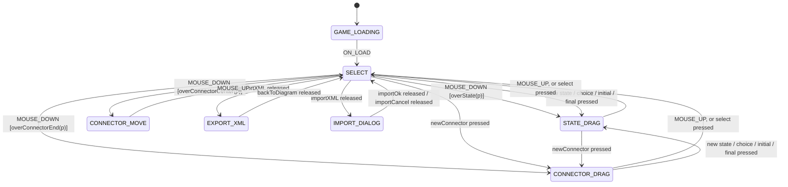

# stateGEN XML version 2: enough to generate the working editor

> **Note (12 November 2026):** TypeScript code generation has since been removed from this project, so
> students write their own code from the diagrams. The XML format described here is still what the editor
> reads and writes. The parts about generated code (`gameStates.ts`, `connectToPage()`, `?generated`,
> `deno task generate`) are kept only as a record of the design.

**Status:** implemented, W1–W9 (see §8) · **Date:** 8 November 2026 · **Branch:** `uml-state-chart-style`

## 1. Goal

`examples/stateGEN-itself.xml` is the state machine of the Flash stateGEN editor, written in stateGEN's own
`game.xml` format. Version 2 should let that file, plus a hand-written actions class, produce
`gameStates.ts` that **drives the working TypeScript editor**. In other words, the generated code should be
able to replace the hand-written State pattern classes in `src/editor/` (`StateGenEditor`, `EditorState`
and `src/editor/states/*`).

**Assumptions:**

- Every toolbar and dialog button exists in `public/index.html` with the id the XML gives it.
- The model stays hand-written, and so does most of the view: `Diagram`, `Layout`, `XmlImporter`/`Exporter`,
  `TypeScriptGenerator`, `DiagramView`, `PropertiesPanel`, `Viewport`.
- The XML describes the **controller**: which state the editor is in, which events it reacts to there, which
  named actions run, and which state comes next. It doesn't contain the code of those actions.

## 2. Where version 1 stands

### 2.1 What happens to `stateGEN-itself.xml` today

| Part of the file | What happens today |
| --- | --- |
| 6 states, 25 transitions | Imported and drawn. `gameStates.ts` is generated and type-checks. |
| Button events (`EVENT_BUTTON_ON_PRESS_newStateButton` …) | Imported. `connectToPage()` listens to the HTML element with each id. |
| Mouse events (`EVENT_ON_MOUSE_DOWN/UP/MOVE`) | Imported as mouse events. The generated methods have **no mouse position**. |
| `EVENT_KEY_DOWN_222` (the `#` key) | Imported as key code 222. The working editor uses Delete and Backspace instead. |
| Action code longer than one call (11 places) | **Dropped**, with a warning. It is ActionScript 2 (`_global`, `startDrag`, `hitTest`, `removeMovieClip`). |
| `nextEvent = EVENT_GO_STATE_DRAG` inside `ON_MOUSE_DOWN` | The code is dropped. The 3 `EVENT_GO_*` events become user-defined events that **nothing ever fires**. |
| `frameName='select'` … | Becomes `gotoFrame("select")`. An HTML page has screens, not Flash frames. |

### 2.2 How it compares with the working editor

The hand-written TypeScript editor has more than the XML describes:

| The working editor has | `stateGEN-itself.xml` has |
| --- | --- |
| Tools for choice, initial, final and tidy up; import | None of these (the Flash version had no code for them) |
| Mouse down picks the state, connector center or connector end under the mouse | Picks in ActionScript, then raises `EVENT_GO_*` |
| States that carry data: `StateDragState(dragged, grabOffset)`, `ConnectorDragState(connector, whichEnd)` | Everything in a global `game` object (`game.nearestStateIndex`, `game.isStart` …) |
| Each state says how to draw things (`stateLook`, `connectorLook`, `showsDiagram`) | `if (state == STATE_SELECT)` inside `drawStateObjects()` |
| Delete or Backspace deletes the selection | Key code 222 |
| Pan, zoom, fit, double-click to rename, Properties panel editing | Not part of the state machine (see §6) |

## 3. Gaps, and how version 2 closes them

| # | Gap | Effect on the generated code | Version 2 fix | Section |
| --- | --- | --- | --- | --- |
| G1 | Action bodies are ActionScript code | Lost on import; nothing for the generator to call | Named actions only, as a list of `<action call='…'/>` | 4.1 |
| G2 | Events carry no data (mouse position) | `onMouseDown()` can't know where the mouse is | Pointer events pass `p: Point` to actions and guards | 4.2 |
| G3 | Decisions are made in action code, then `nextEvent = …` | The `EVENT_GO_*` transitions can never happen | Guards on the same event, which import as a choice diamond | 4.3 |
| G4 | State data lives in the global `game` object | Generated states have no data | Data stays in the hand-written actions class; states hold none | 4.4 |
| G5 | Drawing depends on the state | The view can't ask the generated state anything | Typed `<property>` values on a state | 4.5 |
| G6 | `frameName` is a Flash frame | `gotoFrame()` means nothing in a page | `screen='…'` names an HTML element to show | 4.6 |
| G7 | Start state only by convention (`STATE_GAME_LOADING`) | Works, but is implicit | `<initialState newState='…'/>` (already supported by the importer) | 4.7 |
| G8 | Mouse down anywhere counts, including on the toolbar and panel | A tool press also fires a diagram mouse down | `<mouseArea id='diagram'/>`: mouse down counts only there | 4.8 |
| G9 | Keys only by number; no Delete or Backspace | Can't express the working delete key | `DELETE` and `BACKSPACE` added to the special keys | 4.9 |
| G10 | Import, choice, initial, final and tidy-up events are missing | Those tools would do nothing | Add them, plus an import dialog state | 5 |
| G11 | One action per transition, enter and exit | Most Flash bodies did several things | `<action>` repeats; the generator already handles action lists | 4.1 |

## 4. Version 2 XML additions

Version 2 files say so with `<game version='2'>`. Version 1 files (with no `version`) still import exactly as
they do now. Everything below is optional, so a version 1 file is also a valid version 2 file.

### 4.1 Named actions (G1, G11)

Action code is replaced by a list of calls, in order:

```xml
<event id='EVENT_BUTTON_ON_PRESS_newStateButton' newState='STATE_STATE_DRAG'>
	<action call='createStateAt(p)'/>
</event>

<enterStateActions>
	<action call='showGeneratedFiles'/>
</enterStateActions>
```

- The **generator** adds each name to `GameActions` and calls them in order. A transition runs: exit the old
  state, then the transition's actions, then enter the new state (the same order as now).
- The **importer** still accepts the version 1 body `doSomething();`, which means `<action call='doSomething'/>`.
  Several calls (`drawScene(); findHover(p);`) become a list. Any other code is still dropped with a
  warning.
- The **editor** model needs a list instead of one name:
  - `Connector.transitionFunctionName` becomes `actions: string[]`.
  - `DiagramState.enterStateFunction` and `exitStateFunction` become lists too.
  - The Properties panel shows each list as one field, with the names separated by commas.

Why not allow TypeScript code in the XML? Code in XML can't be type-checked, linted or tested where it's
written. It is also what made the Flash file unportable. Keeping the code in the actions class keeps that
logic testable, and keeps the generated State pattern classes short.

### 4.2 Event data: the mouse position (G2)

Some events come from the pointer: mouse down, up and move, and button press and release. On these, an
action or guard written **`name(p)`** is passed the mouse position:

```xml
<event id='EVENT_ON_MOUSE_MOVE'><action call='dragStateTo(p)'/></event>
```

```ts
override onMouseMove(p: Point): void {
  this.game.actions.dragStateTo(p);
}
```

- The `(p)` is written on purpose, rather than worked out by the generator. A diagram that never says
  `(p)`, such as the gumball machine, generates exactly the signatures it did before
  (`insertCoin(): void`), and the diagram itself shows which actions use the mouse.
- An event method takes `p: Point` only if one of its actions or guards says `(p)`. `Game`'s method, and
  the general `onButtonPress(id, p)` lookup, pass it on.
- An action's signature in `GameActions` is `(p: Point)` if it is only ever called with `(p)` on a
  pointer event, `(p?: Point)` if it is also called without it (for example as an enter action), and `()`
  otherwise. An implementation is free to ignore `p`.
- `p` is in **diagram coordinates**. `connectToPage()` takes a `toPoint` option to convert from the page
  (the editor passes `diagramView.toDiagram`, which allows for pan and zoom). Its default is relative to
  the top-left of the `<mouseArea>` element, or of the page.
- The generated file declares `export interface Point { x: number; y: number }` when it is needed.
- Key and frame events carry no data. `(p)` on them is called without `p`.

### 4.3 Decisions with guards, not raised events (G3)

The Flash `ON_MOUSE_DOWN` code finds what is under the mouse, then sets `nextEvent = EVENT_GO_STATE_DRAG`.
Version 2 writes the same decision as **one event with guards**:

```xml
<event id='EVENT_ON_MOUSE_DOWN' guard='overState(p)' newState='STATE_STATE_DRAG'>
	<action call='grabStateAt(p)'/>
</event>
<event id='EVENT_ON_MOUSE_DOWN' guard='overConnectorCenter(p)' newState='STATE_CONNECTOR_MOVE'>
	<action call='grabConnectorAt(p)'/>
</event>
<event id='EVENT_ON_MOUSE_DOWN' guard='overConnectorEnd(p)' newState='STATE_CONNECTOR_DRAG'>
	<action call='grabConnectorEndAt(p)'/>
</event>
<event id='EVENT_ON_MOUSE_DOWN' guard='else'>
	<action call='deselect'/>
</event>
```

This already works with what version 1 has:

- The importer turns "same event, different guards" into a **choice diamond**.
- The generator turns it into `if / else if / else`.

So the editor's own diagram shows the decision, which is the point of the lecture. The only change is that
guards written `name(p)` receive `p`. The guard `overState(p)` becomes the method
`overState(p: Point): boolean`.

The `EVENT_GO_*` user-defined events are no longer needed.

*Alternative considered:* let actions raise events (`this.game.raise("GO_STATE_DRAG")`). That copies the Flash
design, but it hides the decision inside an action, where the diagram can't show it. It would also need an
event queue to avoid changing state from inside an action. Rejected.

### 4.4 Where the state data lives (G4)

The hand-written states keep their data in constructor parameters. For example, `StateDragState` holds the
state being dragged and where it was grabbed. Generated states are created as `new StateX(this.game)`, so
they can't.

**Decision:** the data lives in the hand-written actions class (`StateGenActions implements GameActions`):

- `selectedState`, `selectedConnector`, `hover…`, `dragged`, `grabOffset`, `draggedEnd`
- The actions that set them: `grabStateAt(p)`, `createConnectorAt(p)` …

The generated states hold no data. This is the version 1 `game` object again, but typed, private and behind
named actions.

*Trade-off:* hand-written states with constructor parameters are better object-oriented design. A generated
machine needs a fixed shape, though. A version 3 could declare data on a state, for example
`<parameter name='dragged' type='DiagramState'/>`, with `newState` arguments filled in from actions. That is
left as an open question (§10).

### 4.5 State properties for the view (G5)

The view needs to ask the current state a few questions. A state can now declare typed, constant
properties:

```xml
<state id='STATE_CONNECTOR_DRAG' screen='diagram-screen'>
	<property name='showSnapHandles' type='boolean' value='true'/>
	<property name='connectorMoving' type='boolean' value='true'/>
	...
</state>
```

The generator does two things with them:

- Each property name becomes a `readonly` field on `GameState`, with a default (`false`, `0` or `""`).
- Each state that sets the property overrides it.

The view reads `game.currentState.showSnapHandles` instead of calling `stateLook()`. Every default is
`false`, `0` or `""`, so a property is named for what is *unusual* (`hidesDiagram`, not `showsDiagram`).
The properties that are needed:

| Property | Set in | What the view does |
| --- | --- | --- |
| `highlightHover` | SELECT | Highlights the state or connector under the mouse |
| `showSnapHandles` | CONNECTOR_DRAG | Shows the red handles on the state the dragged end is near |
| `connectorMoving` | CONNECTOR_DRAG, CONNECTOR_MOVE | Draws the dragged connector as "moving" |
| `hidesDiagram` | LOADING, EXPORT_XML | Hides the diagram |

### 4.6 Screens instead of frames (G6)

`screen='export-screen'` names the HTML element to show when the state is entered. The generator:

- calls `this.game.actions.showScreen("export-screen")` in `enter()`;
- adds `showScreen(id: string): void` to `GameActions`.

`connectToPage()` could also provide a default that shows that element and hides the other screens. The
version 1 `frameName` still imports, and means the same as `screen`.

### 4.7 Initial state (G7)

`<initialState newState='STATE_GAME_LOADING'/>` makes the start explicit. The importer and generator already
support it. `stateGEN-itself.xml` just needs the line.

### 4.8 Where mouse events count (G8)

`<mouseArea id='diagram'/>` changes where `connectToPage()` listens:

| Event | Listened for on |
| --- | --- |
| Mouse down | The `#diagram` element only |
| Mouse move and up | The whole window, so a drag that leaves the diagram (or starts on a toolbar button) carries on |

With no `<mouseArea>`, every mouse event is listened for on the whole page, as now.

### 4.9 Keys (G9)

- `DELETE` (46) and `BACKSPACE` (8) are added to `SPECIAL_KEYS`, so the event ids are `EVENT_KEY_DOWN_DELETE`
  and `EVENT_KEY_DOWN_BACKSPACE`.
- `connectToPage()` ignores key events while the user is typing in an `<input>` or `<textarea>`, as `main.ts`
  does now. Without this, Backspace in the Properties panel would delete the selected state.

## 5. `stateGEN-itself` in version 2

This is the editor as it works today, written in version 2. It would be saved as
`examples/stateGEN-itself-v2.xml`, and the old file kept for comparison. The `x`/`y` layout attributes are
left out here.



The full file:

```xml
<?xml version="1.0" ?>
<game version='2'>

<!-- ****************************** BUTTON INSTANCE NAMES  ******************** -->
<buttonInstanceList>
	<button id='selectButton'/>
	<button id='newStateButton'/>
	<button id='newChoiceButton'/>
	<button id='newInitialButton'/>
	<button id='newFinalButton'/>
	<button id='newConnectorButton'/>
	<button id='tidyUpButton'/>
	<button id='exportXMLButton'/>
	<button id='importXMLButton'/>
	<button id='importOkButton'/>
	<button id='importCancelButton'/>
	<button id='backToDiagramButton'/>
</buttonInstanceList>

<!-- NEW: mouse down only counts on the diagram; moves and releases count anywhere -->
<mouseArea id='diagram'/>

<!-- INITIAL STATE -->
<initialState newState='STATE_GAME_LOADING'/>

<!-- ****************************** STATE ******************** -->
<state id='STATE_GAME_LOADING'>
	<property name='hidesDiagram' type='boolean' value='true'/>
	<event id='EVENT_ON_LOAD' newState='STATE_SELECT'/>
</state>

<!-- ****************************** STATE ******************** -->
<state id='STATE_SELECT' screen='diagram-screen'>
	<property name='highlightHover' type='boolean' value='true'/>

	<event id='EVENT_ON_ENTER_FRAME'><action call='drawScene'/></event>
	<event id='EVENT_ON_MOUSE_MOVE'><action call='findHover(p)'/></event>

	<!-- what is under the mouse decides the next state: a choice diamond on the diagram -->
	<event id='EVENT_ON_MOUSE_DOWN' guard='overState(p)' newState='STATE_STATE_DRAG'>
		<action call='grabStateAt(p)'/>
	</event>
	<event id='EVENT_ON_MOUSE_DOWN' guard='overConnectorCenter(p)' newState='STATE_CONNECTOR_MOVE'>
		<action call='grabConnectorAt(p)'/>
	</event>
	<event id='EVENT_ON_MOUSE_DOWN' guard='overConnectorEnd(p)' newState='STATE_CONNECTOR_DRAG'>
		<action call='grabConnectorEndAt(p)'/>
	</event>
	<event id='EVENT_ON_MOUSE_DOWN' guard='else'><action call='deselect'/></event>

	<event id='EVENT_BUTTON_ON_PRESS_newStateButton' newState='STATE_STATE_DRAG'><action call='createStateAt(p)'/></event>
	<event id='EVENT_BUTTON_ON_PRESS_newChoiceButton' newState='STATE_STATE_DRAG'><action call='createChoiceAt(p)'/></event>
	<event id='EVENT_BUTTON_ON_PRESS_newInitialButton' newState='STATE_STATE_DRAG'><action call='createInitialAt(p)'/></event>
	<event id='EVENT_BUTTON_ON_PRESS_newFinalButton' newState='STATE_STATE_DRAG'><action call='createFinalAt(p)'/></event>
	<event id='EVENT_BUTTON_ON_PRESS_newConnectorButton' newState='STATE_CONNECTOR_DRAG'><action call='createConnectorAt(p)'/></event>

	<event id='EVENT_BUTTON_ON_RELEASE_tidyUpButton'><action call='tidyUp'/></event>
	<event id='EVENT_BUTTON_ON_RELEASE_exportXMLButton' newState='STATE_EXPORT_XML'/>
	<event id='EVENT_BUTTON_ON_RELEASE_importXMLButton' newState='STATE_IMPORT_DIALOG'/>

	<event id='EVENT_KEY_DOWN_DELETE'><action call='deleteSelected'/></event>
	<event id='EVENT_KEY_DOWN_BACKSPACE'><action call='deleteSelected'/></event>
</state>

<!-- ****************************** STATE ******************** -->
<state id='STATE_STATE_DRAG' screen='diagram-screen'>
	<event id='EVENT_ON_ENTER_FRAME'><action call='drawScene'/></event>
	<event id='EVENT_ON_MOUSE_MOVE'><action call='dragStateTo(p)'/></event>
	<event id='EVENT_ON_MOUSE_UP' newState='STATE_SELECT'><action call='dropStateAt(p)'/></event>
	<event id='EVENT_BUTTON_ON_PRESS_selectButton' newState='STATE_SELECT'/>
	<event id='EVENT_BUTTON_ON_PRESS_newConnectorButton' newState='STATE_CONNECTOR_DRAG'><action call='createConnectorAt(p)'/></event>
</state>

<!-- ****************************** STATE ******************** -->
<state id='STATE_CONNECTOR_DRAG' screen='diagram-screen'>
	<property name='showSnapHandles' type='boolean' value='true'/>
	<property name='connectorMoving' type='boolean' value='true'/>

	<event id='EVENT_ON_ENTER_FRAME'><action call='drawScene'/></event>
	<event id='EVENT_ON_MOUSE_MOVE'><action call='dragConnectorEndTo(p)'/></event>
	<event id='EVENT_ON_MOUSE_UP' newState='STATE_SELECT'/>
	<event id='EVENT_BUTTON_ON_PRESS_selectButton' newState='STATE_SELECT'/>
	<event id='EVENT_BUTTON_ON_PRESS_newStateButton' newState='STATE_STATE_DRAG'><action call='createStateAt(p)'/></event>
	<event id='EVENT_BUTTON_ON_PRESS_newChoiceButton' newState='STATE_STATE_DRAG'><action call='createChoiceAt(p)'/></event>
	<event id='EVENT_BUTTON_ON_PRESS_newInitialButton' newState='STATE_STATE_DRAG'><action call='createInitialAt(p)'/></event>
	<event id='EVENT_BUTTON_ON_PRESS_newFinalButton' newState='STATE_STATE_DRAG'><action call='createFinalAt(p)'/></event>
</state>

<!-- ****************************** STATE ******************** -->
<state id='STATE_CONNECTOR_MOVE' screen='diagram-screen'>
	<property name='connectorMoving' type='boolean' value='true'/>

	<event id='EVENT_ON_ENTER_FRAME'><action call='drawScene'/></event>
	<event id='EVENT_ON_MOUSE_MOVE'><action call='moveConnectorTo(p)'/></event>
	<event id='EVENT_ON_MOUSE_UP' newState='STATE_SELECT'/>
</state>

<!-- ****************************** STATE ******************** -->
<state id='STATE_EXPORT_XML' screen='export-screen'>
	<property name='hidesDiagram' type='boolean' value='true'/>
	<enterStateActions><action call='showGeneratedFiles'/></enterStateActions>

	<event id='EVENT_BUTTON_ON_RELEASE_backToDiagramButton' newState='STATE_SELECT'/>
</state>

<!-- ****************************** STATE ******************** (NEW) -->
<state id='STATE_IMPORT_DIALOG' screen='diagram-screen'>
	<enterStateActions><action call='openImportDialog'/></enterStateActions>
	<exitStateActions><action call='closeImportDialog'/></exitStateActions>

	<event id='EVENT_BUTTON_ON_RELEASE_importOkButton' newState='STATE_SELECT'><action call='importFromDialog'/></event>
	<event id='EVENT_BUTTON_ON_RELEASE_importCancelButton' newState='STATE_SELECT'/>
</state>

</game>
```

Things to note:

- **The Flash setup code is gone.** `STATE_GAME_LOADING`'s `<exitStateActions>` created the global `game`
  object. That becomes the constructor of the actions class.
- **Import is now a state** (`STATE_IMPORT_DIALOG`). Today the import `<dialog>` lives outside the state
  machine, in `main.ts`. As a state, it shows the pattern handling a modal dialog: while the dialog is open,
  the tools and the delete key do nothing.
- **Tidy up and delete are internal transitions.** An event with no `newState` runs its actions without
  exiting or entering the state.
- **Selection now happens in the actions.** `grabStateAt` selects the state as well as grabbing it, and
  `create…At` deselects the old selection first. The XML no longer needs the Flash body lines
  `game.selectedStateIndex = -1; showProperties();`.

## 6. Out of scope: stays outside the state machine

These are view or model features. They don't change which state the editor is in, so they stay
hand-written in `main.ts` and `src/view/`:

- Pan (middle-drag), wheel zoom, and the zoom +/−/100%/fit buttons
- Editing fields in the Properties panel (they change the model directly)
- Double-click to rename. It could later become `EVENT_ON_DOUBLE_CLICK` in SELECT.
- The copy and download buttons on the export screen
- The message dialog after an import (`importFromDialog` shows it)

## 7. What the generator produces (sketch)

```ts
export interface Point { x: number; y: number }

export interface GameActions {
  showScreen(id: string): void;
  drawScene(): void;
  findHover(p: Point): void;
  grabStateAt(p: Point): void;
  createStateAt(p: Point): void;
  deselect(): void;
  // ... one method per <action call>; (p: Point) only for the ones written name(p)
  /** guard [overState(p)] */
  overState(p: Point): boolean;
  overConnectorCenter(p: Point): boolean;
  overConnectorEnd(p: Point): boolean;
}

export abstract class GameState {
  readonly highlightHover: boolean = false;
  readonly showSnapHandles: boolean = false;
  readonly connectorMoving: boolean = false;
  readonly hidesDiagram: boolean = false;
  // ... enter(), exit(), one method per event, as now (pointer events take p: Point)
}

export class StateSelect extends GameState {
  readonly name = "STATE_SELECT";
  override readonly highlightHover = true;

  override onMouseDown(p: Point): void {
    if (this.game.actions.overState(p)) {  // [overState(p)]
      this.game.changeState(new StateStateDrag(this.game), () => this.game.actions.grabStateAt(p));
    } else if (this.game.actions.overConnectorCenter(p)) {  // [overConnectorCenter(p)]
      this.game.changeState(new StateConnectorMove(this.game), () => this.game.actions.grabConnectorAt(p));
    } else if (this.game.actions.overConnectorEnd(p)) {  // [overConnectorEnd(p)]
      this.game.changeState(new StateConnectorDrag(this.game), () => this.game.actions.grabConnectorEndAt(p));
    } else {  // [else]
      this.game.actions.deselect();
    }
  }
}

export function connectToPage(
  game: Game,
  options: { page?: Document; toPoint?: (e: PointerEvent) => Point } = {},
): void { /* buttons by id, mouse on #diagram then window, keys (not while typing), every frame, onLoad */ }
```

`Game` also gains an optional `onStateChanged(state)` callback, so the page can show the current state's
name, as the banner does now.

## 8. Work items

| # | Work | Files | Tests | Status |
| --- | --- | --- | --- | --- |
| W1 | Lists of actions on connectors and on state enter/exit; edit them in the Properties panel as comma-separated names | `Connector.ts`, `DiagramState.ts`, `PropertiesPanel.ts`, `Transitions.ts` | Editor and XML round trip | Done |
| W2 | Import and export `<action call>`, `version`, `screen`, `<property>`, `<mouseArea>` | `XmlImporter.ts`, `XmlExporter.ts` | v2 round trip is identical; v1 files still import | Done |
| W3 | Pointer events and guards take `p: Point`; work out action signatures | `TypeScriptGenerator.ts` | Generated signatures | Done |
| W4 | State properties, `showScreen`, `onStateChanged` | `TypeScriptGenerator.ts` | Generated fields and overrides | Done |
| W5 | `connectToPage` options: `toPoint`, mouse area, ignore keys while typing | `TypeScriptGenerator.ts` | Generated code type-checks with the DOM library | Done |
| W6 | `DELETE` and `BACKSPACE` special keys | `TransitionEvents.ts` | Key event ids | Done |
| W7 | Show state properties and the screen on the Properties panel for a state | `PropertiesPanel.ts`, `DiagramState.ts` | Editor test | Done |
| W8 | Write `examples/stateGEN-itself-v2.xml` (§5) and add it to the examples | `examples/`, `src/examples.ts` | Imports with no warnings | Done |
| W9 | **The proof:** add `StateGenActions implements GameActions`, generate `src/editor/generated/gameStates.ts` from W8, and run the app on it behind a switch | `src/editor/`, `src/main.ts` | The behaviours in `editor_test.ts` pass when run against the generated machine | Done |

W1 to W6 are useful on their own, for any game. W8 and W9 prove the whole thing.

**Notes on W1–W6 as built:**

- The model fields are `Connector.actions`, `DiagramState.enterActions` / `exitActions`, `screen` and
  `properties`, and `Diagram.version` / `mouseArea` (helpers in `src/model/Actions.ts`).
- `frameName` stays a separate field from `screen`: a version 1 file keeps `gotoFrame("…")`, and a
  version 2 one gets `showScreen("…")`. `gotoFrame` is only declared if a state has a frame name, or no
  state has a screen.
- A diagram is written as version 2 if it was imported as version 2, or uses a screen, a state property or
  a mouse area. Otherwise it is written as version 1 exactly as before. The one difference is that
  several actions are kept as one `name();` line each, where a version 1 import used to drop them.
- Version 1 action code that is only function calls (`drawScene(); assertRadioButtonHandlers();`) now
  imports as a list, rather than being dropped.
- The Properties panel edits the action lists, the screen, and the properties as one line of text,
  e.g. `highlightHover = true, zoom = 1.5, label = "hi"` (the type comes from the value). The diagram's
  mouse area can't be edited there yet; it comes from the XML.

**Notes on W7–W9 as built:**

- `examples/stateGEN-itself-v2.xml` is §5, and is also in the Import dialog's examples. It imports with no
  warnings, and the mouse down shows as a choice diamond with the four guards.
- `deno task generate` (`tools/generate_editor.ts`) writes `src/editor/generated/gameStates.ts` from it.
  A test fails if the file is out of date. The generated folder is left out of `deno fmt`, so the file is
  exactly what the generator writes.
- `src/editor/StateGenActions.ts` implements `GameActions`. `src/editor/GeneratedEditor.ts` wraps the
  generated `Game` in the same `Editor` interface as the hand-written `StateGenEditor`
  (`src/editor/Editor.ts`). Its `look` works out how to draw things from the current state's properties.
- `tests/editor_test.ts` runs every test against both editors; `tests/generated_editor_test.ts` adds
  tests for the import dialog state and the properties.
- In the page, `?generated` switches to the generated editor, and the generated `connectToPage()` does all
  the event wiring, with `toPoint` set to `diagramView.toDiagram`. Pan, zoom, double-click to rename and
  the copy/download buttons stay in `main.ts` (§6). Escape on the import dialog is passed on as the cancel
  button, so it goes through the state machine too.
- Two small generator changes came out of this. Mouse down and up (and button presses) only count for the
  main mouse button, because the middle button pans. A state's event method names its argument `_p` when
  that state doesn't use it, so the generated file passes `deno lint`.

## 9. Acceptance criteria

1. `stateGEN-itself-v2.xml` imports with **no warnings**, and the editor shows the mouse-down choice diamond.
2. The generated `gameStates.ts` type-checks (`deno check` with the `dom` library).
3. With the generated machine plus `StateGenActions`, the app behaves as it does now. Everything in
   `editor_test.ts` passes: drawing, dragging, connecting, selecting, deleting, export and import.
4. Exporting the imported v2 file gives back the same XML.
5. Every version 1 example still imports and exports exactly as before. Its generated code differs only
   by `Game.onStateChanged`, the `connectToPage(game, { page })` options object, and ignoring keys while
   typing.

## 10. Open questions

1. **State data** (§4.4): is data in the actions class acceptable for teaching? Or should version 2 already
   allow parameters on states, which is closer to the hand-written `StateDragState(dragged, grabOffset)`?
2. **Generated or hand-written editor:** should the generated machine *replace* `src/editor/states/`? Or should
   both live side by side, so students can compare the hand-written classes with the generated ones?
3. **Typed properties:** are `boolean`, `number` and `string` enough? Or should the view's `StateLook`
   values (`"snap"`, `"hover"` …) be properties directly?
4. **Repeated transitions:** the tool-press transitions are repeated in three states. Should version 2 allow
   them on a parent (composite) state? That is a UML feature stateGEN doesn't have yet, and a much bigger
   change.
